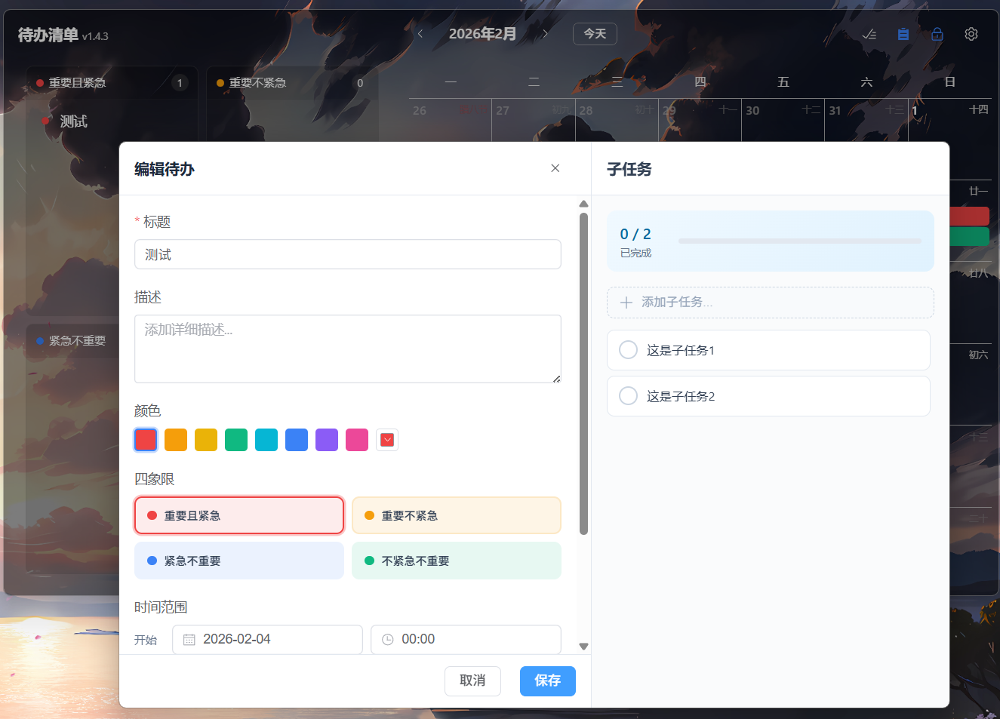

# Mini Todo

一款简洁高效的 Windows 桌面待办事项管理应用，基于 Rust + [GPUI](https://github.com/zed-industries/zed/tree/main/crates/gpui) 开发，
单个 `mini-todo.exe`，**不需要 WebView2**。

> 3.0 起桌面端由 Tauri + Vue 版换成了 GPUI 重写版：界面、功能与 2.x 一致，数据完全互通，安装包会原地升级 2.x 并保留全部数据。
> 3.0 起只提供 Windows x64 版本（不再提供 macOS / Linux 桌面包）。




## 功能特性

### 待办管理
- 以列表模式 / 四象限模式展示待办项（支持子任务）
- 待办描述支持 Markdown（GFM 表格 / 任务清单 / 删除线），支持粘贴 / 拖入上传图片，图片点击可预览
- 编辑描述时为"Markdown 源码 + 实时预览"，另有源码 / 预览分栏的放大编辑弹窗（可最大化）
- 点击待办默认进入只读详情：简化排版突出内容，展示标题、Markdown 渲染的描述、通知状态与优先级，可一键切换到编辑模式
- 子任务支持标题 + 内容分离，内容同样是 Markdown，可粘贴 / 拖入图片；可从 .md / .txt 文件或文件夹批量导入
- 子任务列表双击可快捷内联编辑标题
- 支持日历展示，以及自定义颜色
- 列表 / 四象限模式都支持拖拽排序
- 系统提醒（Windows 通知或应用内通知），支持按天 / 周 / 月重复提醒

### 云同步（WebDAV）
- 支持通过 WebDAV 协议进行云端数据同步（兼容坚果云、NextCloud、Apache / nginx 自建等）
- 同步数据包含待办事项、子任务、图片与部分应用设置
- 逐条合并：多台设备（以及云端 API）同时修改不同待办时都会保留，同一条待办以最后一次修改为准；
  删除会同步到其它设备，不会被"复活"
- 支持定时自动同步 + 手动一键同步；设置页另有"用云端覆盖本地 / 用本地覆盖云端"（带二次确认）
- 同步在后台线程执行，不会卡住界面；同步数据采用 Gzip 压缩
- 数据本身不加密，建议使用 https 的 WebDAV 地址；WebDAV 密码用系统 DPAPI 加密保存
- 升级提示：多台设备共用一个 WebDAV 时，请把所有 PC 端与云端 API 一起升级（PC 2.5.0 / cloud 0.3.0 起）。
  更旧的版本仍是"整库覆盖"式同步，混用期间旧版本那一侧仍可能丢失尚未同步的改动

### 日历模式
- 月视图日历
- 支持农历、节气、传统节日与法定节假日显示
- 支持调休上班日标记（节假日数据源）

#### 数据来源
- 法定节假日与调休上班日：NateScarlet/holiday-cn（联网拉取 JSON，失败时使用本地缓存）
  - https://raw.githubusercontent.com/NateScarlet/holiday-cn/master/{year}.json
- 农历 / 节气 / 传统节日：[tyme4rs](https://github.com/6tail/tyme4rs)（结果与 [lunar-javascript](https://github.com/6tail/lunar-javascript) 逐日比对一致）

### 窗口特殊功能
- **普通模式**：可拖拽移动、调整大小；可切换深色主题并自定义界面底色与背景透明度（半透明融入桌面）
- **固定模式**：
  - 固定在当前位置，不可拖动、不可缩放，不占任务栏
  - 可选贴边自动隐藏、唤起时置顶
  - 可选"固定模式时，嵌入桌面中"：窗口嵌在桌面图标之上、其它窗口之下，按 Win+D 显示桌面时不会被隐藏（需要 Windows 11 24H2 及以上）
- 多屏幕位置记忆（重启后根据显示器配置，保持窗口位置）

### 桌面收纳箱
- 托盘「新增收纳箱」在桌面上创建收纳区域，把桌面上的文件 / 快捷方式 / 文件夹拖进去即可收纳
- 收纳是真实移动：文件放在 `%USERPROFILE%\MiniTodo收纳箱\<收纳箱名>\` 下，重名自动加 ` (2)`，绝不覆盖；删除收纳箱时全部移回原位置
- 双击打开、右键菜单（打开所在位置 / 隐藏 / 移回桌面 / 移动到其它收纳箱）、箱内拖动排序、Ctrl+滚轮调图标大小、双击标题改名、折叠、固定、自定义外观
- 隐藏图标：以 `.` 开头的文件自动隐藏，也可以右键隐藏单个图标；「更多」→「显示隐藏的图标」可按收纳箱切换（隐藏只影响收纳箱的显示，不改文件属性）
- 收纳箱始终嵌在桌面层，Win+D 后仍可见；按显示器组合记忆位置

### 系统功能
- 系统托盘图标（单击唤起主窗口，右键菜单可快速添加待办、管理收纳箱、切换固定模式）
- 开机自启动
- 版本更新检查
- 数据导入 / 导出（导入与数据库升级前自动备份到 `backups/`，保留最近 5 份）
- 运行日志写入本地日志文件，便于排查问题
- WebDAV 云同步配置（设置页面内集成）

## 安装

前往 [Releases](https://github.com/dreamlonglll/mini-todo/releases) 页面下载最新版本（仅 Windows 10 / 11 x64）：

- **安装包** `mini-todo_<版本>_x64-setup.exe`：双击安装，默认装到 `%LOCALAPPDATA%\mini-todo`，可选创建桌面快捷方式。
  已安装 2.x（Tauri 版）时会先卸载旧版再安装，待办、设置、图片都会保留；卸载只删除程序文件，不会删除数据
- **便携版** `mini-todo_<版本>_x64-portable.zip`：解压后直接运行 `mini-todo.exe`
- 每个版本附带 `SHA256SUMS.txt`，可用于校验下载文件
- 不需要安装 WebView2 Runtime

数据位置（安装版、便携版、2.x 旧版共用同一份）：

- 数据库、图片、备份：`%LOCALAPPDATA%\mini-todo\`
- 日志：`%LOCALAPPDATA%\com.tauri-app.mini-todo\logs\mini-todo.log`（目录名沿用旧版，反馈问题时附上即可）
- 桌面收纳箱里的文件：`%USERPROFILE%\MiniTodo收纳箱\`

注意：

- 同一时间只运行一个 Mini Todo。再次启动（包括启动另一份便携版或 2.x 旧版）时，新启动的那个会直接退出并把已运行的窗口唤到前台；
  想切换版本，先在托盘菜单里"退出"当前版本
- 开启了开机自启时，最后一次运行的那个程序会把启动项更新成自己的路径
- 从 2.x 升级的已知差异：描述 / 子任务的 Markdown 编辑由"所见即所得"改为"源码 + 实时预览"（渲染效果、图片粘贴 / 拖入上传、链接打开规则不变）；
  多行中文的换行位置可能与旧版差一个字（逗号、句号等全角标点偶尔会出现在行首）

## 开发

### 环境要求
- Rust 最新 stable
- 在 Windows 上构建 release 版需要安装 Visual Studio 2022 生成工具，勾选"使用 C++ 的桌面开发"（提供 MSVC 链接器与 **Windows SDK**）。
  release 构建会用 Windows SDK 里的 `fxc.exe` 预编译着色器；找不到时可以用环境变量 `GPUI_FXC_PATH` 指向它（如
  `C:\Program Files (x86)\Windows Kits\10\bin\<版本>\x64\fxc.exe`）
- Linux 上可以编译运行（需要 `libxkbcommon-dev libwayland-dev libvulkan-dev libfontconfig-dev` 等，完整列表见
  [`.github/workflows/pc-gpui-ci.yml`](.github/workflows/pc-gpui-ci.yml)），只用于 CI、截图回归与端到端测试

PC 端代码在 `pc-gpui/`（Cargo workspace），所有命令在 `pc-gpui/` 下执行：

```bash
cd pc-gpui
cargo run -p mini-todo                                   # debug 运行
cargo fmt --all -- --check
cargo clippy --workspace --all-targets --locked -- -D warnings
cargo test --workspace --locked
cargo build --release -p mini-todo --locked              # release（仅 Windows，需要 Windows SDK）→ target\release\mini-todo.exe
```

- 与已安装的正式版同时调试时，用 `MINI_TODO_DATA_DIR=<临时目录>` 启动 debug 构建（隔离数据、日志，不占用单实例与开机自启项）。
- 请用 **release** 构建分发或拷到别的电脑。debug 构建的 exe 不内嵌着色器，运行时要按构建机上 Rust 依赖缓存（cargo registry）里的绝对路径
  读取着色器源码现场编译，拷到其它机器上会因为找不到这些文件而无法启动。Linux 不能交叉构建出可用的 Windows 版。
- 安装包与便携包由 GitHub Actions 的 `release.yml` 在推送 `v*` tag 时构建（NSIS 脚本 `pc-gpui/scripts/windows-installer.nsi`）。
- 截图回归与端到端测试：[`pc-gpui/scripts/README.md`](pc-gpui/scripts/README.md)、
  [`pc-gpui/scripts/e2e-linux/README.md`](pc-gpui/scripts/e2e-linux/README.md)（Linux，真实应用 + WebDAV + 云端 API）、
  [`pc-gpui/scripts/e2e-windows/README.md`](pc-gpui/scripts/e2e-windows/README.md)（Windows，真实窗口与输入）。
- 代码结构与约定：[`pc-gpui/crates/app/README.md`](pc-gpui/crates/app/README.md)（界面 / 窗口 / 平台）、
  [`pc-gpui/crates/core/README.md`](pc-gpui/crates/core/README.md)（业务核心）。

## 技术栈

| 层级 | 技术选型 | 说明 |
|------|----------|------|
| UI 框架 | GPUI（gpui-kit 0.7.3：gpui-pre + gpui-component） | Zed 编辑器的 GPU 加速 UI 框架，Windows 上用 DirectX 11 绘制，不依赖 WebView |
| 界面控件 | 自绘 Element Plus 风格控件 | 图标为 Element Plus Icons |
| 业务核心 | Rust（`mini-todo-core`） | 数据库、同步、导入导出、提醒、收纳箱文件层 |
| 数据库 | SQLite（rusqlite） | 轻量级本地数据库 |
| 云同步协议 | WebDAV（reqwest） | 兼容坚果云、NextCloud 等 |
| 农历 | tyme4rs | 与 lunar-javascript 同一作者 |
| 安装包 | NSIS | 仅 Windows x64，另有便携 zip |
| 云端 API | Rust + Axum | 独立 HTTP 服务，供 AI Skill / cron 读写待办 |

## 项目结构

> 项目按平台拆分子目录：`pc-gpui/` 为 Windows 桌面端，`cloud/` 为云端 HTTP API（Rust + Axum），未来可平行加入 `mobile/`、`web/`。

```
mini-todo/
├── pc-gpui/                     # PC 端（Rust Cargo workspace）
│   ├── crates/core/             # 业务核心（数据库 / 同步 / 导入导出 / 提醒 / 收纳箱文件层）
│   ├── crates/app/              # GPUI 界面、窗口与平台集成（托盘、通知、开机自启……）
│   └── scripts/                 # 截图回归、端到端测试脚本、Windows 安装器脚本
├── cloud/                       # 云端 HTTP API（Rust + Axum，独立 crate）
│                                # 通过 WebDAV 与 PC 端共用同一份数据；详见 cloud/README.md
└── docs/                        # 共享文档
```

## 云端 API（可选）

如需在 PC 之外通过 AI（如 Claude Code Skill）读写自己的待办，可在 VPS 上部署 `cloud/`
子项目。它通过 WebDAV 与 PC 端共用 `sync-data.json.gz` 通道，因此不要求 PC 在线。
每个版本的 Release 里附带 `minitodo-cloud` 的 Linux 二进制（x86_64 / aarch64）。

部署与 REST API 详情见 [`cloud/README.md`](cloud/README.md)。

### Claude Code Skill

安装配套 Skill 后，Claude Code 可直接查看/创建/更新待办：

```bash
# Linux/macOS
bash cloud/skill/minitodo/install.sh
# Windows PowerShell
.\cloud\skill\minitodo\install.ps1
```

脚本会把 `SKILL.md` / `minitodo.py` / `config.example.toml` 拷贝到
`~/.claude/skills/minitodo/`，并提示编辑 `config.toml` 填入云端 `endpoint` 与 `api_key`。

完成后即可使用：

```bash
python ~/.claude/skills/minitodo/minitodo.py today --json    # 今日待办
python ~/.claude/skills/minitodo/minitodo.py add "买菜"       # 新增
python ~/.claude/skills/minitodo/minitodo.py done C3          # 标记完成
python ~/.claude/skills/minitodo/minitodo.py sync             # 手动同步
```

Skill 使用规则见 [`cloud/skill/minitodo/SKILL.md`](cloud/skill/minitodo/SKILL.md)。

### openclaw 临期提醒

通过 [openclaw](https://github.com/anthropics/openclaw) 的 cron 机制，可以让 AI agent
定时检查临期待办并推送到 Slack / Telegram / Discord 等 IM channel：

```bash
# 1. 安装 skill 到 openclaw workspace
bash cloud/skill/minitodo/install.sh --target openclaw

# 2. 编辑 config.toml 填入 endpoint + api_key
nano ~/.openclaw/workspace/skills/minitodo/config.toml

# 3. 注册 cron（每天早 8 点检查临期，推送到 default channel）
openclaw cron add \
  --name minitodo-due-soon \
  --cron "0 8 * * *" \
  --tz "Asia/Shanghai" \
  --session isolated \
  --message "<见 openclaw.md §7 的完整 prompt>" \
  --announce
```

cron 唤起的 agent 会自行拉取所有未完成 todo、按时间锚判断哪些临期/逾期、
组织格式后推送。推送效果示例：

```
mini-todo 临期提醒｜2026-05-14 08:00
已逾期（1）：
  - #C5 [高] 写报告 (05-12 18:00，已逾期 14 小时)
未来 24h 到期（2）：
  - #C7 [中] 买菜 (05-14 10:00，2 小时后)
  - #C2 [低] 周例会 (05-14 14:00，6 小时后｜每周的周三)
```

完整安装步骤、cron message 模板、偏好配置和故障排查见
[`cloud/openclaw.md`](cloud/openclaw.md)。

## 许可证

MIT License

## 致谢

- [GPUI](https://github.com/zed-industries/zed/tree/main/crates/gpui) / [gpui-kit](https://github.com/longbridge/gpui-kit)（含 gpui-component） - UI 框架与组件
- [Element Plus Icons](https://element-plus.org/) - 图标
- [tyme4rs](https://github.com/6tail/tyme4rs) / [lunar-javascript](https://github.com/6tail/lunar-javascript) - 农历/节气计算
- [NateScarlet/holiday-cn](https://github.com/NateScarlet/holiday-cn) - 中国法定节假日数据
- 2.x 及以前的版本基于 [Tauri](https://tauri.app/)、[Vue.js](https://vuejs.org/)、[Element Plus](https://element-plus.org/)、[Milkdown](https://milkdown.dev/) 构建
