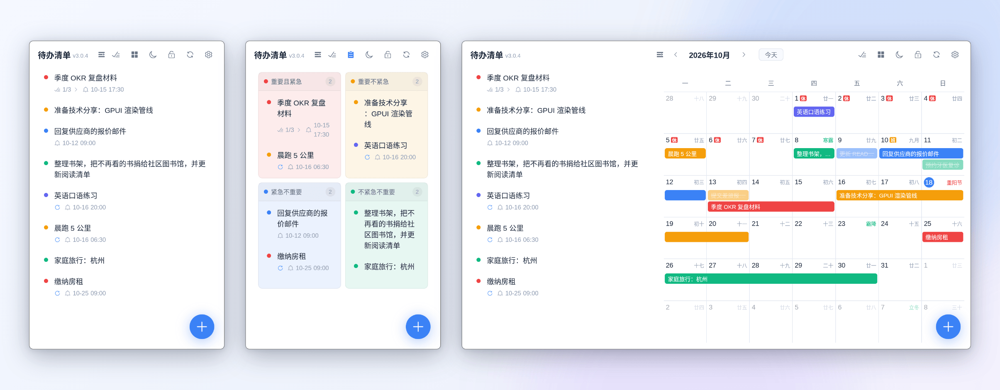
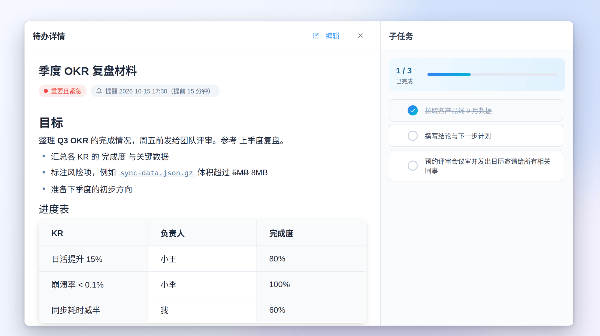
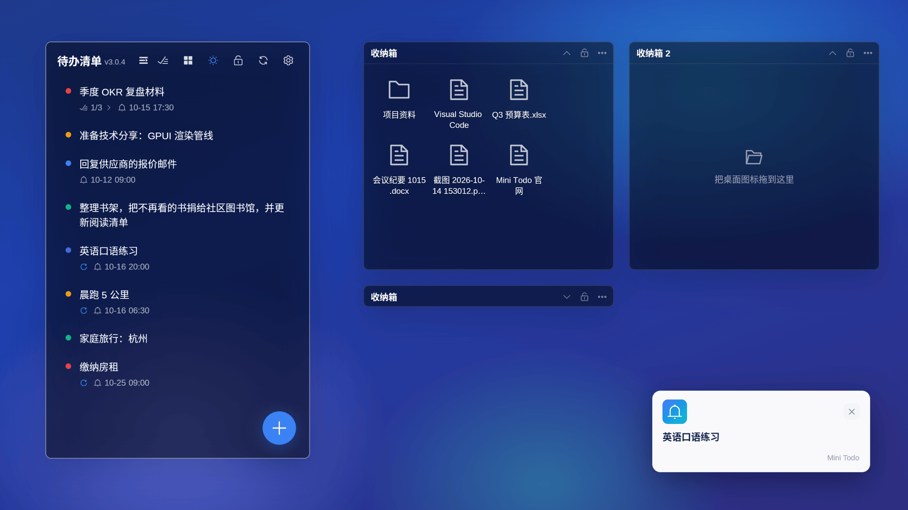
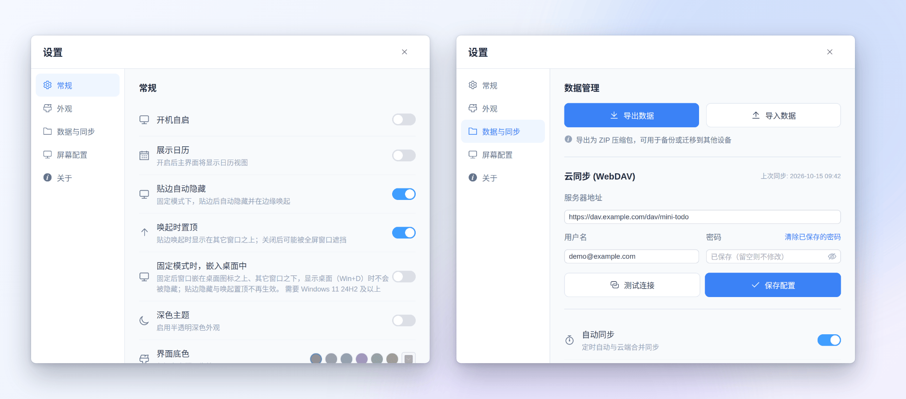

<div align="center">


# Mini Todo

**简洁、聚焦的 Windows / macOS 桌面待办**

原生 GPUI 渲染，无需 WebView2 · 列表 / 四象限 / 日历 · Markdown 与子任务 · 提醒与重复 · 桌面收纳箱 · WebDAV 同步

[下载](https://github.com/dreamlonglll/mini-todo/releases) ·
[功能介绍视频](https://github.com/user-attachments/assets/e19c8fc2-9ec1-403a-b096-43057cc02871) ·
[安装说明](#下载与安装) ·
[常见问题](#常见问题) ·
[云端 API 与 AI](#云端-api-与-ai可选) ·
[参与开发](#开发)

</div>

https://github.com/user-attachments/assets/e19c8fc2-9ec1-403a-b096-43057cc02871

<p align="center">
  <sub>约 2 分钟的功能介绍（应用界面全部截自当前版本的真实应用）；播放不了时可以<a href="docs/video/mini-todo-intro.mp4">下载视频文件</a></sub>
</p>

## 简介

Mini Todo 是一款本地优先的桌面待办应用：数据存在自己电脑的 SQLite 里，不需要注册账号；想在多台电脑之间同步，接上任意 WebDAV
（坚果云、Nextcloud、自建都行）即可。它常驻托盘，可以固定在桌面上随时瞄一眼，也可以贴边自动隐藏、用时再唤出，不打扰你。

3.0 起桌面端用 Rust + [GPUI](https://github.com/zed-industries/zed/tree/main/crates/gpui) 重写：Windows 上是单个 `mini-todo.exe`，
macOS 上是 Apple 芯片 / Intel 通用的 `mini-todo.app`，都**不需要 WebView2**。数据与 2.x 完全互通，安装包会原地升级 2.x 并保留全部数据。

- **Windows 10 / 11（x64）**：正式支持
- **macOS 11+（Apple 芯片 / Intel）**：**预览版**，只在 GitHub Actions 的 macOS 虚拟机上做过自动化测试，未经真机验收，欢迎反馈
- 不提供 Linux 桌面包

## 亮点

- **三种视图**：列表、四象限（拖动即改分类）、日历（农历、节气、法定节假日与调休）
- **写得下细节**：描述与子任务都支持 Markdown（表格、任务清单、代码、链接），粘贴或拖入图片
- **不会忘**：系统通知或应用内通知，提前提醒，按天 / 周 / 月重复
- **融入桌面**：浅色主题与半透明深色主题，固定模式钉在桌面上，Windows 11 24H2+ 还能嵌入桌面
- **桌面收纳箱**：把桌面上的文件真正收进一个个收纳箱，拖动时自动吸附对齐
- **多设备同步**：WebDAV 逐条合并，多台电脑同时改不同的待办也不丢；另有可选的云端 API，让 AI 帮你管待办

## 功能一览

### 列表、四象限、日历



- 标题栏一键切换列表 / 四象限；两种视图都能拖拽排序（按住待办前的颜色圆点拖），四象限之间拖动即可改分类
- 优先级（高 / 中 / 低）与自定义颜色、开始 / 截止时间；未完成的待办可以一键置顶
- 子任务可以就地展开，进度实时计数；标题栏可一键展开 / 收起全部子任务
- 日历模式在设置 → 常规「展示日历」里开启（主窗口随之加宽）：有开始 / 截止时间的待办显示为跨天横条，点击打开详情；
  显示农历、节气、传统节日、法定节假日与调休上班日
- 「已完成」窗口：搜索已完成的待办，恢复为未完成或删除

### 详情、Markdown 与子任务



- 点击待办先进入**只读详情**：标题、Markdown 渲染的描述、提醒状态、优先级，一键切换到编辑
- 描述支持 Markdown（GFM 表格 / 任务清单 / 删除线 / 自动链接）：平时显示渲染结果，单击切到源码编辑；
  另有源码 / 预览左右分栏的放大编辑（可最大化）
- 粘贴或拖入图片即可插入，图片保存在本机，点击可预览
- 子任务有独立的标题与 Markdown 内容（同样支持图片），可从 .md / .txt 文件或整个文件夹批量导入；拖动排序、双击标题改名
- 编辑窗口按 Esc 关闭（有未保存的修改时先确认），Ctrl+Enter（macOS ⌘Enter）保存
- 链接：http / https / mailto 交给系统默认程序，`file:///` 本地文件在资源管理器（macOS 访达）中定位，其它协议一律不打开；
  只读详情里单击打开，编辑时 Ctrl / ⌘ + 单击

### 提醒

- 到点提醒可选**系统通知**（Windows Toast / macOS 通知中心）或**应用内通知**（屏幕右下角的小窗口，多条自下而上叠放，不抢焦点），
  在设置 → 常规「通知方式」里切换
- 准时提醒，或提前 5 / 15 / 30 分钟、1 小时，也可自定义提前时间
- 重复提醒：按天 / 周（可指定周几）/ 月（每月几号）重复，可设间隔；触发后自动推进到下一次，遇到没有该日期的月份取当月最后一天
- 应用启动时补发关闭期间错过的重复提醒

### 外观与窗口



- 浅色 / 深色主题，标题栏一键切换；深色主题可自定义界面底色与背景透明度（半透明，透出桌面）；待办字体与字号（12~20）可调
- **固定模式**（标题栏锁形按钮或托盘菜单）：固定在当前位置，不可拖动、不可缩放，不占任务栏、不参与 Alt+Tab，被 Win+D / Win+M 最小化后自动还原；
  可选贴边自动隐藏、唤起时置顶
- **固定时嵌入桌面**（仅 Windows，设置 → 常规）：窗口嵌在桌面图标之上、其它窗口之下，按 Win+D 显示桌面时也不会被隐藏（需要 Windows 11 24H2 及以上）
- 多屏幕位置记忆：按显示器组合分别记住主窗口的位置、尺寸与是否固定，重启后自动恢复；设置 → 屏幕配置里可查看、删除已保存的组合；
  托盘「重置位置」把主窗口放回主显示器左上区域
- macOS 上的固定模式：不可拖动、不可缩放、被最小化后立即还原，可选贴边自动隐藏与唤起时置顶；没有"不占程序坞"与嵌入桌面

### 桌面收纳箱（Windows；macOS 预览）

- 托盘（macOS：菜单栏图标）右键「新增收纳箱」，在鼠标所在显示器的右上角新建一个收纳箱；把桌面上的文件、快捷方式、文件夹拖进去即可收纳
- **真收纳**：文件真的移动到 `%USERPROFILE%\MiniTodo收纳箱\<收纳箱名>\`（macOS：`~/MiniTodo收纳箱/<收纳箱名>/`），桌面随之变干净；
  重名自动改为 `名字 (2)`，**绝不覆盖**；在资源管理器 / 访达里增删这个文件夹的内容，收纳箱随之刷新
- 删除收纳箱时项目全部移回原位置（原位置不在了就回桌面）；有项目移不回去时不删除，整个收纳箱保留并提示原因
- 双击打开；右键菜单：打开 / 打开所在位置（macOS：在访达中显示）/ 隐藏 / 移回桌面 / 移动到其它收纳箱；箱内拖动排序；
  Ctrl+滚轮调图标大小（macOS 也可以 ⌘+滚轮）；双击标题改名；折叠、固定；每个收纳箱可以单独设置背景色与透明度
- **吸附对齐**：拖动或调整大小时，边靠近其它收纳箱的同一条边（约 10 像素内）就自动对齐，被对齐的收纳箱在那条边上亮一条蓝线；
  按住 Alt（macOS：Option）临时不吸附
- **隐藏图标**：以 `.` 开头的文件自动隐藏，也可以右键隐藏单个图标；「更多」→「显示隐藏的图标」按收纳箱切换（只影响显示，不改文件属性）
- 始终在桌面层：Windows 上嵌在桌面中，Win+D 后仍可见、不占任务栏；macOS 上在桌面图标之上、其它窗口之下，每个桌面空间都能看到，⌘H 不会隐藏它；
  按显示器组合记忆位置；托盘「显示/隐藏所有收纳箱」「重置收纳箱位置」作为兜底入口
- 桌面由 OneDrive（Windows）或 iCloud「桌面与文稿」（macOS）同步时，第一次收纳会提示：移出桌面也会让其他设备的桌面少掉这些项目
- 已知限制：Windows 10 与 Windows 11 23H2 及更早版本上，Win+D 可能会盖住收纳箱

### 同步与备份



- **WebDAV 云同步**（设置 → 数据与同步，可先「测试连接」）：同步待办、子任务、图片与部分应用设置（窗口位置、WebDAV 配置等设备相关的设置不同步）
- **逐条合并**：多台设备（以及云端 API）同时修改不同待办时都会保留，同一条待办以最后一次修改为准；删除也会同步到其它设备，不会被"复活"
- 定时自动同步 + 标题栏一键同步，在后台进行、不卡界面；设置页另有"用云端覆盖本地 / 用本地覆盖云端"（带二次确认）
- **导出 / 导入**：导出为 ZIP 备份（`mini-todo-backup-YYYY-MM-DD.zip`）；导入支持本应用导出的 ZIP / JSON（包括 2.x 导出的），
  **导入会用备份内容覆盖当前的全部待办**；导入与数据库升级前都会自动备份到 `backups/`（保留最近 5 份）

### 系统集成

- 托盘图标 / macOS 菜单栏图标：单击唤起主窗口；右键菜单有添加待办项、新增收纳箱 / 显示或隐藏所有收纳箱 / 重置收纳箱位置、
  固定模式、重置位置、打开设置、开机自启动、退出
- 开机自启动（Windows 注册表启动项 / macOS LaunchAgent）；单实例运行
- 版本更新检查：有新的正式版时，标题栏版本号旁显示红点；也可以在设置 → 关于里手动检查
- macOS：应用菜单与常用快捷键（⌘, 设置、⌘H 隐藏、⌘Q 退出、⌘M 最小化、⌘W 关闭窗口、编辑菜单）；关掉窗口不退出，点程序坞图标重新唤起主窗口
- 运行日志写入本地文件，便于排查问题

## 下载与安装

前往 [Releases](https://github.com/dreamlonglll/mini-todo/releases) 下载（页面上附有各版本的更新说明）。每个版本附带 `SHA256SUMS.txt`
用于校验下载文件。预发布版（版本号带 `-pre`）不会出现在应用内的更新提示里，需要手动下载。

### Windows 10 / 11（x64）

| 文件 | 说明 |
|---|---|
| `mini-todo_<版本>_x64-setup.exe` | 安装包：默认装到 `%LOCALAPPDATA%\mini-todo`，可选创建桌面快捷方式。已安装 2.x 时会先卸载旧版再安装，待办、设置、图片都保留；卸载只删除程序文件，不删数据 |
| `mini-todo_<版本>_x64-portable.zip` | 便携版：解压后直接运行 `mini-todo.exe` |

不需要安装 WebView2 Runtime。

### macOS 11+（预览版，Apple 芯片 / Intel 通用）

1. 下载 `mini-todo_<版本>_universal.dmg`，打开后把 **mini-todo** 拖进「应用程序」。装过 2.5.0 mac 版的直接覆盖即可，数据都保留（两者是同一个应用）
2. 本应用没有 Apple 开发者签名（只有 ad-hoc 签名），第一次打开会被系统拦下，二选一放行：
   - **方法一（推荐）**：终端执行 `xattr -cr /Applications/mini-todo.app`，之后正常双击打开
   - **方法二（不用终端）**：先双击打开一次，在弹框里点「完成」；再打开「系统设置 → 隐私与安全性」，在「安全性」一栏点「仍要打开」并输入登录密码
     （这个按钮只在尝试打开后约一小时内出现）。macOS 15 起「右键 → 打开」已经不能绕过
   - 提示「已损坏，无法打开」时只能用方法一
3. 每次升级后需要重新放行一次。请先拖进「应用程序」再打开：直接在 dmg 或「下载」文件夹里打开时系统会把应用放到临时位置运行，这时无法开启开机自启

与 Windows 版的差异：主窗口没有"嵌入桌面"；固定模式不会把应用从程序坞 / ⌘Tab 里藏起来；导入导出的文件对话框没有扩展名过滤；
WebDAV 密码明文保存在本机数据库中（与 2.5.0 mac 版相同）；系统通知第一次弹出时会请求通知权限。
桌面收纳箱在 mac 上同样只在虚拟机上测过（没测过真实桌面、iCloud 同步的桌面、多个桌面空间 / 台前调度、多显示器与 Retina 屏、改名时的中文输入法）：
点收纳箱不会把 mini-todo 切到前台，只有双击标题改名时会。正常使用不需要额外授权；如果系统询问能否访问「桌面」文件夹，
点「允许」即可（也可以在「系统设置 → 隐私与安全性 → 文件与文件夹」里打开），被拒绝时收纳 / 移回会失败并提示原因；
由于没有开发者签名，升级后系统可能会再问一次。遇到问题请到
[Issues](https://github.com/dreamlonglll/mini-todo/issues) 反馈，最好附上截图与日志。

### 数据放在哪里

| | Windows | macOS |
|---|---|---|
| 数据库、图片、备份 | `%LOCALAPPDATA%\mini-todo\` | `~/Library/Application Support/mini-todo/` |
| 日志（反馈问题时附上） | `%LOCALAPPDATA%\com.tauri-app.mini-todo\logs\mini-todo.log` | `~/Library/Logs/com.tauri-app.mini-todo/mini-todo.log` |
| 收纳箱里的文件 | `%USERPROFILE%\MiniTodo收纳箱\` | `~/MiniTodo收纳箱/` |

Windows 的安装版、便携版与 2.x 旧版共用同一份数据，macOS 版与 2.5.0 mac 版也共用同一份；日志目录名沿用旧版。收纳箱文件夹不在数据目录里，卸载应用或删除数据目录都不会丢文件。

## 常见问题

**从 2.x 升级会丢数据吗？**
不会。3.x 使用同一个数据目录、同一种数据库与同步格式，Windows 安装包会原地升级；macOS 直接覆盖 2.5.0 即可。
已知差异：描述 / 子任务的 Markdown 编辑由"所见即所得"改为"源码 + 实时预览"（渲染效果、图片上传、链接规则不变）；
多行中文的换行位置可能与旧版差一个字（逗号、句号等全角标点偶尔出现在行首）。

**为什么再次启动只是唤出了原来的窗口？**
同一时间只运行一个 Mini Todo。再次启动（包括另一份便携版或 2.x 旧版）时，新启动的那个会直接退出，并把已运行的窗口唤到前台。
想切换版本，先在托盘菜单（macOS：菜单栏图标或 ⌘Q）里"退出"当前版本。开启了开机自启时，最后一次运行的那个程序会把启动项更新成自己的路径。

**同步的数据安全吗？**
同步数据经 Gzip 压缩，但**本身不加密**，传输安全取决于 WebDAV 地址是否是 https（填 http:// 时设置页会提示明文风险），WebDAV 服务商能看到内容。
WebDAV 密码在 Windows 上用系统 DPAPI 加密保存，macOS 上以明文存在本机数据库里。

**多台电脑共用一个 WebDAV 要注意什么？**
请把所有电脑上的 Mini Todo 与云端 API 一起升级到较新的版本（PC 2.5.0 / cloud 0.3.0 起才是逐条合并）。更旧的版本是"整库覆盖"式同步，
混用期间旧版本那一侧仍可能丢失尚未同步的改动。

**日历里的节假日从哪里来？**
法定节假日与调休上班日来自 [NateScarlet/holiday-cn](https://github.com/NateScarlet/holiday-cn)（联网拉取，失败时使用本地缓存）；
农历、节气、传统节日由 [tyme4rs](https://github.com/6tail/tyme4rs) 本地计算。

## 云端 API 与 AI（可选）

想在电脑之外、通过 AI 读写自己的待办，可以在 VPS 上部署 [`cloud/`](cloud/README.md)：一个 Rust + Axum 的 HTTP 服务，
通过同一个 WebDAV 与电脑同步（不要求电脑在线），提供 REST API（列表筛选、增删改、子任务、图片、手动同步）。
每个版本的 Release 附带 `minitodo-cloud` 的 Linux 二进制（x86_64 / aarch64），部署与 API 详情见 [`cloud/README.md`](cloud/README.md)。

**Claude Code Skill**：安装后 Claude Code 可以直接查看 / 新增 / 完成 / 修改待办（需要 Python 3.10+ 与 `requests`，Python 3.10 另需 `tomli`）：

```bash
bash cloud/skill/minitodo/install.sh          # Linux / macOS；Windows PowerShell：.\cloud\skill\minitodo\install.ps1
# 按提示编辑 ~/.claude/skills/minitodo/config.toml，填入云端 endpoint 与 api_key

python ~/.claude/skills/minitodo/minitodo.py today --json    # 今日待办
python ~/.claude/skills/minitodo/minitodo.py add "买菜"       # 新增
python ~/.claude/skills/minitodo/minitodo.py done C3          # 标记完成（C3 是云端分配的短码）
```

使用规则见 [`SKILL.md`](cloud/skill/minitodo/SKILL.md)。配合 [openclaw](https://github.com/openclaw/openclaw) 的定时任务，还可以每天定时检查临期 / 逾期待办，
推送到 Slack / Telegram / Discord 等，安装步骤与提示词模板见 [`cloud/openclaw.md`](cloud/openclaw.md)。

## 开发

PC 端代码在 `pc-gpui/`（Cargo workspace：`crates/core` 业务核心、`crates/app` GPUI 界面与平台集成），命令都在 `pc-gpui/` 下执行：

```bash
cd pc-gpui
cargo run -p mini-todo                                   # debug 运行
cargo fmt --all -- --check
cargo clippy --workspace --all-targets --locked -- -D warnings
cargo test --workspace --locked
cargo build --release -p mini-todo --locked              # Windows release → target\release\mini-todo.exe
```

- **环境**：Rust 最新 stable。Windows release 构建需要 Visual Studio 2022 生成工具（"使用 C++ 的桌面开发"，提供 MSVC 与 Windows SDK 里的 `fxc.exe`，
  也可用 `GPUI_FXC_PATH` 指定）；macOS 构建需要 Xcode Command Line Tools，universal 包与 dmg 的命令见
  [`pc-gpui/scripts/README.md`](pc-gpui/scripts/README.md)；Linux 只用于 CI、截图回归与端到端测试（依赖见 [`pc-gpui-ci.yml`](.github/workflows/pc-gpui-ci.yml)）
- **与正式版同时调试**：用 `MINI_TODO_DATA_DIR=<临时目录>` 启动 debug 构建（数据、日志隔离，不占用单实例与开机自启项）；
  其它 debug 开关见 [`pc-gpui/scripts/README.md`](pc-gpui/scripts/README.md)
- **分发用 release 构建**：Windows 的 debug 构建运行时要从构建机的 cargo 缓存读着色器源码，拷到别的电脑上无法启动
- **测试**：截图回归与冒烟 [`scripts/regress.py`](pc-gpui/scripts/README.md)；端到端测试
  [Linux](pc-gpui/scripts/e2e-linux/README.md) / [Windows](pc-gpui/scripts/e2e-windows/README.md) / [macOS](pc-gpui/scripts/e2e-macos/README.md)；
  mac 的 GPUI 代码在 Linux / Windows 上编不了，只能靠 CI 的 macOS 作业
- **介绍视频与 README 截图**：由 [`pc-gpui/scripts/intro-video/`](pc-gpui/scripts/intro-video/README.md) 从真实应用生成，界面改版后可一键重新生成
- **发布**：推 `v*` tag 由 `release.yml` 构建 Windows 安装包 / 便携包、macOS dmg 与 cloud 二进制，版本号只在 `pc-gpui/Cargo.toml` 一处
- **文档**：代码结构与约定见 [`crates/app/README.md`](pc-gpui/crates/app/README.md)、[`crates/core/README.md`](pc-gpui/crates/core/README.md)；
  项目总览与维护检查清单见 [`CLAUDE.md`](CLAUDE.md)；GPUI 约定、数据兼容、同步协议、验证门槛与发布流程见 [`.trellis/spec/`](.trellis/spec/)
- **云端 API**：独立 crate，在 `cloud/` 下 `cargo test --locked`；Skill 单测 `python3 -m unittest discover -s skill/minitodo -p 'test_*.py'`

### 技术栈

| 层级 | 技术选型 | 说明 |
|------|----------|------|
| UI 框架 | GPUI（gpui-kit 0.7.3：gpui-pre + gpui-component） | Zed 编辑器的 GPU 加速 UI 框架，Windows 用 DirectX 11、macOS 用 Metal 绘制，不依赖 WebView |
| 界面控件 | 自绘 Element Plus 风格控件 | 图标为 Element Plus Icons |
| Markdown | gpui-base TextView + markdown crate | GFM 渲染；编辑为"源码 + 预览" |
| 业务核心 | Rust（`mini-todo-core`） | 数据库、同步、导入导出、提醒、收纳箱文件层 |
| 数据库 | SQLite（rusqlite） | 本地数据库 |
| 云同步 | WebDAV（reqwest） | 兼容坚果云、Nextcloud、Apache / nginx 自建等 |
| 农历 | tyme4rs | 结果与 lunar-javascript 逐日比对一致 |
| 平台集成 | windows crate（Win32）、objc2（AppKit）、tray-icon、notify-rust、auto-launch | 窗口模式与嵌入桌面、托盘 / 菜单栏图标、系统通知、开机自启 |
| 安装包 | NSIS / dmg | Windows x64 安装包与便携 zip；macOS universal dmg（ad-hoc 签名） |
| 云端 API | Rust + Axum | 独立 HTTP 服务，供 AI Skill / 定时任务读写待办 |
| CI / 测试 | GitHub Actions + 本地脚本 | Windows / macOS / Linux 的 lint 与单测、Windows / macOS 端到端测试、发布流水线；Linux 截图回归与端到端测试 |

### 项目结构

```
mini-todo/
├── pc-gpui/                 # 桌面端（Rust Cargo workspace）
│   ├── crates/core/         # 业务核心：数据库 / 同步 / 导入导出 / 提醒 / 收纳箱文件层，不依赖 GUI 框架
│   ├── crates/app/          # GPUI 界面、窗口与平台集成（托盘 / 菜单栏图标、通知、开机自启……）
│   └── scripts/             # 截图回归、端到端测试、介绍视频生成、Windows 安装器与 macOS 打包脚本
├── cloud/                   # 云端 HTTP API（Rust + Axum，独立 crate）与 Claude Code / openclaw Skill
├── docs/
│   ├── 开发文档/             # 项目概述、技术架构、功能需求、UI 设计规范、数据库设计等
│   ├── images/              # README 截图
│   └── video/               # 功能介绍视频与封面
├── .github/                 # CI、端到端测试、发布流水线与各版本发布说明（release-notes/）
├── .trellis/spec/           # 开发规范
└── CLAUDE.md / AGENTS.md    # 项目指南 / AI 助手工作流说明
```

## 许可证

MIT License

## 致谢

- [GPUI](https://github.com/zed-industries/zed/tree/main/crates/gpui) / [gpui-kit](https://github.com/longbridge/gpui-kit)（含 gpui-component）：UI 框架与组件
- [Element Plus Icons](https://element-plus.org/)：图标
- [tyme4rs](https://github.com/6tail/tyme4rs) / [lunar-javascript](https://github.com/6tail/lunar-javascript)：农历 / 节气计算
- [NateScarlet/holiday-cn](https://github.com/NateScarlet/holiday-cn)：中国法定节假日数据
- 2.x 及以前的版本基于 [Tauri](https://tauri.app/)、[Vue.js](https://vuejs.org/)、[Element Plus](https://element-plus.org/)、[Milkdown](https://milkdown.dev/) 构建
